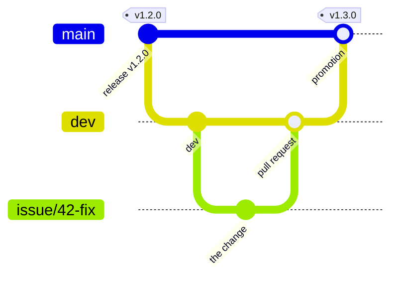

# Contributing

Zabob Retirement is built by a person working with several AI agents, and
the agents follow the same workflow as everyone else. It's written down in
three places: this page, for a person starting out;
[`.github/copilot-instructions.md`](.github/copilot-instructions.md), the
fuller project guide, which the agents read too (architecture, invariants,
conventions); and [`CLAUDE.md`](CLAUDE.md), for branches and worktrees.

## Setting up

Clone the repository and run `./scripts/setup.sh`; [docs/SETUP.md](docs/SETUP.md)
says what it does. The simulator reads its scenarios from a separate data
repository. Without one of your own, `scripts/link-data.sh --template` gives
the tests and spell checker the template data.

## Branches



- **`dev`** is where work lands. Branch from `origin/dev`, name the branch
  `issue/<number>-<short-description>`, and open the pull request against
  `dev`.
- **`main`** moves only when `dev` is promoted: one pull request, merged
  after the whole test suite has
  passed on it. So `main` is always fully tested. Releases are tagged on it.
- **A hotfix**, a fix `main` can't wait for, branches from `origin/main`
  rather than `dev`, on a branch named `hotfix/<number>-<short-description>`,
  and goes to `main` in a pull request labeled `hotfix`. Then the same
  commits go to `dev` from a branch named `issue/<number>-<short-description>`
  (made at the hotfix branch's tip), so each branch's name says where it
  merges.
- **`release/x.y`** branches exist only when a release needs one; see
  [Releasing](docs/releasing.md#branches-and-versions).

"Fixes #N" in a pull request into `dev` doesn't close the issue: GitHub acts
on it only in a pull request into `main`. The issue closes when `dev` is
promoted, and the promotion's pull request lists every issue it closes.

## Promoting dev

The maintainer decides when `dev` is promoted. Until then, a promotion is
always open: the **Promotion** workflow
([`.github/workflows/promotion.yml`](.github/workflows/promotion.yml)) runs
`scripts/promote_dev.py` on every push to `dev`, which opens the promotion
as a draft when none is open and otherwise refreshes its body, so what is
waiting for `main` is listed in one place. It acts with the
`PROMOTION_TOKEN` secret, a fine-grained personal access token for this
repository (Pull requests: read and write, Contents: read); renew it when
it expires. Without it, the promotion is opened by `github-actions[bot]`,
which needs the repository setting "Allow GitHub Actions to create and
approve pull requests" (Settings, Actions, General), and its Gates runs
wait for approval.

With Claude Code, `/promote` (the skill in
[`.claude/skills/promote/`](.claude/skills/promote/SKILL.md)) is the
fallback when that workflow's run failed, and the step before merging: it
checks the promotion's body against `dev`'s merges, refreshes it if needed,
then watches it, fixing review findings and Gates failures in pull requests
into `dev`, and says when it is clean to merge. It never merges.

Without Claude, run the script by hand, signed in to `gh`, or rerun the
workflow ("Run workflow" on the Promotion workflow):

```sh
.venv/bin/python scripts/promote_dev.py --dry-run   # the body it would write
.venv/bin/python scripts/promote_dev.py             # open or refresh the draft
```

Check the body before marking the promotion ready: every merged pull
request is listed, and every issue meant to close has a "Fixes" line. A pull
request into `dev` whose own body had no closing line closes nothing, so
add the line to the promotion by hand; refreshing the body keeps a "Fixes"
line added that way. Fix anything review or Gates finds in a pull request
into `dev` and run the script again to refresh the body.
If the body says main has changes `dev` lacks (a hotfix merged straight to
main), merge `origin/main` into `dev` through a pull request first, so
`dev`'s Gates test what main will get.
Merge only when that fix is on `dev`.

## A pull request

1. Open it as a **draft**. Checks and reviews skip drafts, so iterate there
   with the local gates (below).
2. Before marking it ready, merge `origin/dev` into the branch and resolve
   any conflicts, so the review sees the final change.
3. Mark it ready. That runs the **Gates** workflow once, at quick depth:
   the blocked-keyword, lint, type, spelling and markdown checks, and the
   tests [`tests/areas.toml`](tests/areas.toml) maps to the files you
   changed. A change to the simulator's core selects the whole suite, which
   then runs on `dev` after merge rather than here; label the pull request
   `full-gates` to run all of it before merge instead.
4. If a ready pull request needs several more pushes, turn it back into a
   draft first, so they cost one more run instead of several.

A failure that reaches `dev` anyway is found by the full run after merge.
`scripts/bisect_dev.py TEST...` names the merge that caused it; fix it
forward, or revert that merge.

## The local gates

Run these before marking a pull request ready:

```sh
.venv/bin/python scripts/affected_tests.py --slow   # the tests your change affects
.venv/bin/python -m ruff check src tests plugins    # lint
.venv/bin/ty check                                  # types
npm run spell                                       # spelling
npm run markdownlint                                # markdown
```

`.venv/bin/python -m pytest -q -n auto -m "not slow"` runs the everyday
suite, and `.venv/bin/analysis sim check --all` checks that real scenarios
still load after a change to the simulator or its loader.

## Things to know

- **Real names stay out.** Account, person and payee names from anyone's
  real data never go in this repository: code, tests, docs, commit messages
  and pull requests use the example household (Alice and Bill). A hook and
  the Gates check block commits with words that give real names away; see
  [docs/SETUP.md](docs/SETUP.md#blocked-keywords).
- **The architecture decision records are the specification.** Read
  [docs/architecture/](docs/architecture/README.md) before changing the
  simulator, and update the record a change makes wrong in the same pull
  request.
- **Money is integer cents** past the loader, and spaces, never tabs, indent
  every file.
- **Notebooks are committed without output**; the setup script installs the
  `nbstripout` filter that strips it.
