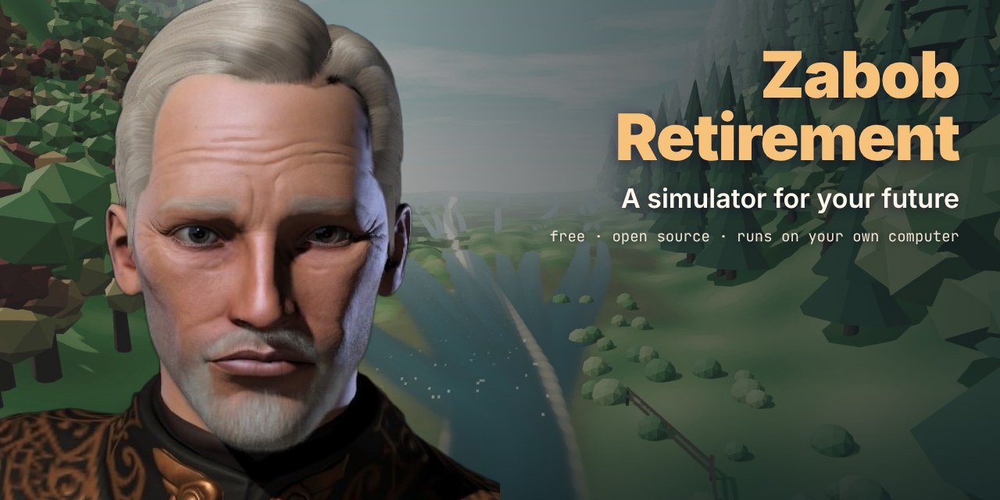

# Zabob Retirement



*A simulator for your future.* Zabob Retirement is a retirement simulator for
exploring your options and possible futures, at home, at your own pace, and
for free. Compare what-if scenarios side by side, and run hundreds of
simulated futures to see the range of outcomes, not just one number.

- **Guidelines:** check a plan against the 4% rule, or let Guyton-Klinger
  guardrails adjust your spending.
- **Taxes:** federal and state tax worked out each year, including Medicare's
  IRMAA surcharge, required minimum distributions, Roth conversions, capital
  gains and home sales.
- **Future changes to the rules:** a new tax table from the date a law takes
  effect, or a move to another state.
- **A range of outcomes:** ensembles vary returns, inflation, lifespans and
  more across hundreds of runs.

Your data stays on your computer, in a git repository of plain CSV files.

## Install

With [uv](https://docs.astral.sh/uv/) (it fetches Python 3.14 if you don't
have it):

```sh
uv tool install zabob-retirement
sim init --example     # Alice and Bill's household, to try things on
sim init               # or your own, in ~/zabob-retirement
```

`sim init` makes the data repo your default, so the commands find it from any
folder and shell, Windows PowerShell included.

Upgrade with `uv tool upgrade zabob-retirement`, then `sim notebooks copy
--replace` for the new notebooks. `analysis jupyter` opens the notebooks.

## Learn more

- [User guide](https://github.com/BobKerns/zabob-retirement/blob/main/docs/user-guide.md)
- [Setup](https://github.com/BobKerns/zabob-retirement/blob/main/docs/SETUP.md),
  including working from a clone of the code
- Videos: the *Retirement Simulator Guide* on
  [YouTube](https://www.youtube.com/channel/UCQnUgmsanqEqAj1I-0i7vOA/), in
  English and Japanese
- [Source and issues](https://github.com/BobKerns/zabob-retirement)
