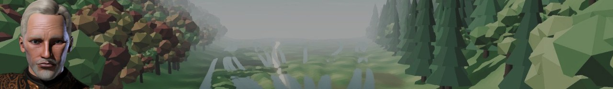

# Brand assets

The images that give the docs one look: Zabob, your host, in front of a 3D
scene of a braided stream, many channels of possible futures flowing through
one valley.

| File | Size | Used for |
| --- | --- | --- |
| [`banner.jpg`](banner.jpg) | 1280 × 186 | The strip at the top of every user-facing doc page |
| [`hero.jpg`](hero.jpg) | 1280 × 640 | The top of the README |
| [`social-card.jpg`](social-card.jpg) | 1280 × 640 | GitHub's social preview (Settings, General), and link cards elsewhere |
| [`banners/`](banners/) | 1280 × 186 | One per doc page, titled with its heading, colored by its part of the docs |
| [`logo/`](logo/) | | The mark and the name: `icon.svg`, `lockup-dark.svg` (for dark pages), `lockup-light.svg`, and PNGs of the lockups |
| [`favicon/`](favicon/) | 16 to 512 | `favicon.svg`, `favicon.ico` (16, 32, 48), `icon-<size>.png` (180 is Apple's touch icon) |

## The logo: a fan of futures

One starting point, and a widening range of outcomes from it, with the
median in gold: what an ensemble shows, in one mark. Every path leaves the
start heading the same way and spreads as it goes, since the near future is
nearly known and the far one isn't. The favicons below 64 pixels keep only
the range and the median, which is all that reads at that size.


## Colors

From the video course's palette (`docs/videos/theme/theme.toml`):

| Use | Color |
| --- | --- |
| Background, the logo's tile | `#10242f` |
| Text on it | `#f4efe6` |
| The median; the user guide and other pages | gold, `#f2a541` |
| The range of outcomes; the guides | teal, `#4fb3a9` |
| The videos | terracotta, `#e07a5f` |
| The architecture | slate, `#8aa6d6` |

The scene is toned down on purpose: it is illustration, there to frame the
page, and must not compete with the text. The scene's light comes from the
right, the same side as the key light on Zabob's portrait; keep the two
matching in any new scene.

## Adding the banner to a page

Each page has a banner of its own, made from its first heading, with its
part of the docs named above the title and shown in the stripe at the bottom
(`SECTIONS` in `src/brand.py`: architecture, guides, videos, and the user
guide for the rest). For a new page, put any banner line on its first line,
above its title, for instance the shared one:

```markdown


# The page's title
```

then make its banner, which also points the line at it:

```sh
.venv/bin/python docs/assets/brand/src/brand.py banners
```

Run it again when a page's title changes, or a page moves or goes:
`tests/test_brand.py` fails until the banners match the pages. The title is
outlined (drawn as shapes) in the SVG, since GitHub shows a markdown image
without web fonts; that needs the Inter fonts installed (`fonts-inter` on
Debian and Ubuntu; [rsms.me/inter](https://rsms.me/inter/) for macOS).

Video scripts don't carry it: they are read by the video pipeline, not as pages.

## Remaking the images

The sources are in [`src/`](src/):

- `stream.html`: the 3D scene (three.js), with views `hero` and `banner`.
- `stream-scene.jpg`, `stream-strip.jpg`: its renders, at full color. These
  are the masters the images are made from.
- `host.png`: Zabob, cut out of his portrait.
- `banner.html`, `hero.html`, `social-card.html`: each image as a page.

`src/brand.py` makes the logo, the favicons and the banners (above):
`.venv/bin/python docs/assets/brand/src/brand.py` from the repository's top
makes everything; `logo` or `banners` makes one part. The banners are drawn
over `src/banner-background.jpg`, `banner.jpg` saved smaller, since each SVG
carries its own copy.

For the scene, from `src/`, with the repository's Python and the pre-installed Playwright:

```sh
node render.js     # optional: re-render the scene to stream-*.png (needs the network for three.js)
python mute.py     # tone the renders down: scene.jpg, strip.jpg
node shot.js       # render the three pages to ../banner.jpg, ../hero.jpg, ../social-card.jpg
```

`render.js` runs WebGL in software, so it needs no GPU. A fresh render of the
`banner` view frames the valley a little differently from the committed
`stream-strip.jpg`.
